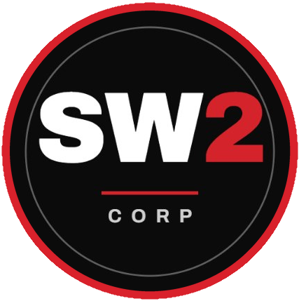

<p align="center"></p>
<h1 align="center">SW2 Corporation</h1>
<p align="center">Documentazione del progetto didattico di Ingegneria del Software 2026/27<br>Università degli Studi di Padova</p>
<p align="center">
<a href="https://sw2-corporation.github.io/docs/"></a>
<a href="https://github.com/SW2-Corporation/docs/actions/workflows/verifica.yml"></a>
<a href="https://github.com/SW2-Corporation/docs/actions/workflows/pubblica.yml"></a>
</p>

## Il sito

I documenti approvati, le Lettere di Presentazione e i verbali sono pubblicati su **[sw2-corporation.github.io/docs](https://sw2-corporation.github.io/docs/)**. Il sito si rigenera da questo repository a ogni push su `main`: sul sito vanno solo le versioni rilasciate, mai le bozze. Il menu in alto porta alle quattro pagine: Documenti (lettere, documenti, verbali e gruppo, con lo stato del progetto in apertura), Pianificazione, Ruoli e Glossario, con la ricerca dei termini. La pagina [Ruoli](https://sw2-corporation.github.io/docs/ruoli.html) mostra chi ricopre quale ruolo oggi e la linea del tempo dei periodi di `dati/ruoli.csv`. La pagina [Pianificazione](https://sw2-corporation.github.io/docs/pianificazione.html) mostra il diagramma di Gantt di fasi, attività e milestone di `dati/pianificazione.toml`, con il tempo previsto e quello usato.

Ogni PDF si apre in una pagina di lettura del sito, con lo stesso nome e l'estensione `.html`. La pagina funziona anche su telefono e offre testo selezionabile, link attivi, zoom e il pulsante per scaricare il PDF. Usa pdf.js da jsDelivr, con versione e impronte SRI fissate in `strumenti/sito.py` (`PDFJS`, `SRI_PDFJS`). Se pdf.js non si carica, la pagina offre il PDF da scaricare.

## Il gruppo

| Membro | GitHub |
|---|---|
| Davide Baraldo | [@davidebaraldo](https://github.com/davidebaraldo) |
| Matteo Bellato | [@matt8227](https://github.com/matt8227) |
| Patrizio Eleuteri | [@gin3773](https://github.com/gin3773) |
| Oussama Mahdi | [@MahdiOussama](https://github.com/MahdiOussama) |
| Alessandro Paduret | [@AlessandroPaduret](https://github.com/AlessandroPaduret) |
| David Sirbu | [@davidsirbu](https://github.com/davidsirbu) |

Contatti: [sw2corporation@gmail.com](mailto:sw2corporation@gmail.com). Ruoli e rotazione: [`documenti/interni/ruoli.md`](documenti/interni/ruoli.md).

## Come è fatto il repository

I documenti sono scritti in [Typst](https://typst.app) 0.15; il sito con i PDF pubblicati si genera da questo repo.

```
assets/          logo del gruppo; font/ con i caratteri del sito e le loro licenze OFL
dati/            gruppo, ruoli, ore, preventivo, pianificazione, glossario, nomi propri ammessi nei titoli
documenti/
  esterni/       gestionali/ e tecnici/: documenti con registro delle modifiche
  interni/       documenti interni con registro (es. Norme di Progetto)
  lettere/       Lettere di Presentazione, AAAA-MM-GG.typ
  verbali/       interni/ ed esterni/, AAAA-MM-GG.toml
presentazioni/   slide 16:9; diari/AAAA-MM-GG.typ per il diario di bordo
modello/
  comuni.typ     dati condivisi e funzioni g(), rif-web(), rif-doc(), data-it(), tabelle del preventivo
  stile.typ      stile globale: pagina, testo, titoli, tabelle, liste, intestazione e piè di pagina
  copertina.typ  copertina dei documenti
  registro.typ   registro delle modifiche letto dal CSV
  persone.typ    tabella dei partecipanti
  documento.typ  template dei documenti con registro
  lettera.typ    template della Lettera di Presentazione
  verbale.typ    template dei verbali (legge un TOML)
  slide.typ      template delle presentazioni
  diario.typ     modello del diario di bordo, da copiare in presentazioni/diari/
strumenti/       controlli automatici, test e generazione del sito
```

Ogni documento `X.typ` ha accanto il suo registro delle modifiche `X.registro.csv`. Lettere e verbali non hanno registro.

## Compilare

```sh
make                 # tutto in build/, con le stesse cartelle dei sorgenti
make watch F=documenti/esterni/gestionali/dichiarazione-impegni.typ   # ricompila al salvataggio
make watch F=documenti/verbali/interni/2026-10-14.toml
make clean
```

Senza `make` si compila sempre con `--root .`, perché i percorsi che iniziano con `/` sono relativi alla radice del repo:

```sh
typst compile --root . documenti/esterni/gestionali/dichiarazione-impegni.typ
cp modello/diario.typ presentazioni/diari/2026-10-26.typ   # nuovo diario, poi si modifica
typst compile --root . presentazioni/diari/2026-10-26.typ
typst compile --root . modello/verbale.typ verbale.pdf --input dati=documenti/verbali/interni/2026-10-14.toml
```

Il percorso del verbale si può scrivere con o senza `/` iniziale; su Git Bash per Windows va scritto senza, perché la shell riscrive i percorsi che iniziano con `/`.

## Nuovi documenti

- **Documento con registro**: un file `X.typ` con `#show: documento.with(titolo: ..., uso: "esterno", destinatari: (...), registro: csv("X.registro.csv"))` (vedi `documenti/esterni/gestionali/`) e accanto `X.registro.csv` con la sola intestazione `versione,data,autore,verificatore,descrizione`. `sottotitolo:` è facoltativo. La copertina ricava versione, stato (Bozza, In verifica, Approvato), redattori, verificatori e approvatore dal registro.
- **Lettera di Presentazione**: `documenti/lettere/AAAA-MM-GG.typ` con `#show: lettera.with(data: "AAAA-MM-GG", oggetto: "...")`, poi il testo.
- **Verbale**: `documenti/verbali/interni/AAAA-MM-GG.toml` (o `esterni/`). Più verbali dello stesso tipo nello stesso giorno aggiungono al nome un suffisso in minuscolo, per gli esterni il codice del capitolato: `2026-10-20-c7.toml`, con decisioni `VE-2026-10-20-C7.n`. Campi:

  ```toml
  tipo = "interno"                 # "interno" | "esterno", come la cartella
  titolo = "..."                   # facoltativo: oggetto, sul sito e nel PDF; senza, l'azienda o il primo punto
  data = 2026-10-14                # uguale alla data del nome del file
  inizio = "18:00"
  fine = "19:00"
  luogo = "Discord"
  redattore = "Nome Cognome"
  verificatore = "Nome Cognome"    # diverso dal redattore
  partecipanti = ["Nome Cognome"]
  assenti = []                     # facoltativo
  esterni = [{ nome = "", ruolo = "", azienda = "" }]   # solo esterni
  approvazione_esterna = ""        # solo esterni, es. "Approvato via email il 2026-10-16"
  ordine_del_giorno = ["..."]

  [[punto]]
  titolo = "..."
  sintesi = """..."""

  [[decisione]]
  id = "VI-2026-10-14.1"           # VE- per gli esterni
  testo = "..."
  motivazione = "..."

  [[azione]]
  decisione = "VI-2026-10-14.1"
  descrizione = "..."
  assegnatario = "Nome Cognome"    # un membro, mai "tutti"
  scadenza = 2026-10-20
  issue = "https://github.com/..." # URL della issue
  ```

  Il verbale non ha copertina, versione né registro: intestazione con orari e durata, partecipanti, poi ordine del giorno, sintesi, decisioni e azioni. Gli esterni riportano l'approvazione del proponente, "in attesa" finché manca.
- **Presentazione**: `presentazioni/diari/AAAA-MM-GG.typ` per il diario di bordo, con `#show: presentazione.with(evento: "Diario di bordo", data: "AAAA-MM-GG", titolo: "...")` e una `#slide(titolo: "...")[...]` per ogni slide. La prima slide è il titolo; ogni slide riporta evento, data, logo e numero "n/N". Poco testo: il resto si dice a voce.

## Pianificazione

`dati/pianificazione.toml` contiene le fasi del progetto in ordine, ognuna con le sue attività e milestone. Da qui il sito genera `pianificazione.html`; i documenti Typst, per esempio il Piano di Progetto, leggono gli stessi dati con `toml("/dati/pianificazione.toml")`.

```toml
[[fase]]
nome = "Candidatura"
nota = "..."                     # facoltativa
inizio = 2026-10-12              # previsto
fine = 2026-10-30
inizio_effettivo = 2026-10-12    # quando accade
fine_effettiva = 2026-10-30      # assente = in corso
ore_previste = 0                 # facoltativo

  [[fase.attivita]]
  nome = "Valutazione dei capitolati"
  inizio = 2026-10-19
  fine = 2026-10-28
  inizio_effettivo = 2026-10-18

  [[fase.milestone]]
  nome = "Invio della candidatura"
  data = 2026-10-30
  data_effettiva = 2026-10-30    # quando è raggiunta
```

- Gli effettivi si scrivono quando accadono, mai in anticipo: una data effettiva futura è un errore.
- Le fasi non si sovrappongono. Le ore usate di una fase sono le righe di `dati/ore.csv` che cadono nel suo periodo effettivo.
- La pagina si apre con la situazione di oggi: fase in corso, prossima milestone, attività concluse, ore usate e voci in ritardo. Nel Gantt la fascia grigia è il previsto e la barra colorata l'effettivo, fino a oggi se la voce è in corso; il colore dice lo stato (verde conclusa, blu in corso, rosso a righe in ritardo). Ogni riga riporta stato e giorni usati su previsti; le date esatte sono nella tabella sotto ogni fase.
- Il sito si rigenera anche ogni notte, perché stato e giorni usati dipendono dalla data.

## Personalizzare lo stile

- Colore d'accento: `colore` in `dati/gruppo.toml` (es. `"#D7262F"`). Il sito lo usa per barre, bottoni e testi in evidenza; sugli sfondi scuri lo schiarisce da solo per tenere il contrasto sopra 4,5:1. Con un colore molto chiaro il contrasto sul tema chiaro va ricontrollato.
- Logo: il file in `assets/` e il suo percorso in `logo` di `dati/gruppo.toml`.
- Caratteri del sito: Atkinson Hyperlegible Next per testo e titoli, Atkinson Hyperlegible Mono per date e numeri, disegnati per la massima leggibilità. Stanno in `assets/font/` con la loro licenza SIL OFL e il sito li serve da sé, senza servizi esterni.
- Tutto il resto dei documenti (font, titoli, tabelle, liste, intestazione e piè di pagina): `modello/stile.typ`.

## Verifica

```sh
make verifica        # oppure: python strumenti/verifica.py
make test            # oppure: python -m unittest discover -s strumenti
python strumenti/verifica.py documenti/esterni/gestionali/dichiarazione-impegni.typ
```

Senza argomenti `verifica.py` controlla tutto il repo (`dati/`, `documenti/`, `modello/`, `presentazioni/`), altrimenti solo i file indicati. Ogni problema è una riga `percorso:riga: CODICE messaggio`: i codici `E-` sono errori e fanno fallire la CI, i `W-` sono avvisi. Basta Python 3.11 o successivo, senza librerie esterne.

## Pubblicazione

A ogni push su `main`, e ogni notte, il workflow `pubblica.yml` ripete i controlli, compila i documenti e pubblica il sito su GitHub Pages (in Settings > Pages la sorgente deve essere "GitHub Actions"). Sul sito vanno i documenti rilasciati, tutte le lettere e tutti i verbali, in ordine LIFO; le presentazioni no. Anteprima locale:

```sh
make sito            # oppure: python strumenti/sito.py --out build/site
```

Il sito segue il tema chiaro o scuro del dispositivo; il bottone in alto a destra lo cambia e ricorda la scelta nel browser. Pagine con salto al contenuto, navigazione da tastiera, testi alternativi e contrasti conformi a WCAG 2.2 AA.

## Convenzioni

- Date sempre AAAA-MM-GG, nel testo e nei nomi dei file; orari HH:MM.
- Verbali e lettere non hanno registro delle modifiche.
- Il registro delle modifiche è in ordine LIFO: la prima riga è la più recente.
- Ogni riga del registro è una modifica già verificata: prima si verifica, poi si incrementa la versione (Z per le modifiche minori, Y per quelle sostanziali). Autore e verificatore sono persone diverse.
- Solo l'approvazione del Responsabile in carica incrementa X e rilascia il documento: la riga ha il verificatore vuoto e la descrizione che inizia con "Approvazione".
- Nei titoli solo la prima parola ha l'iniziale maiuscola, salvo acronimi e nomi propri elencati in `dati/maiuscole.txt`.
- I termini del glossario si marcano con `g("termine")` alla prima occorrenza, mai nei titoli.
- Tabelle e figure stanno in una `figure` con didascalia: sopra per le tabelle, sotto per le figure.
